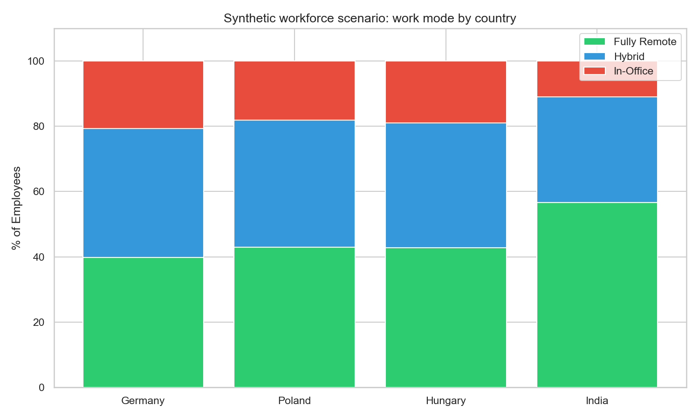
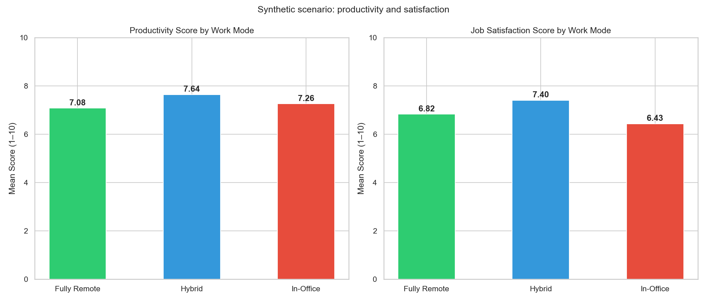
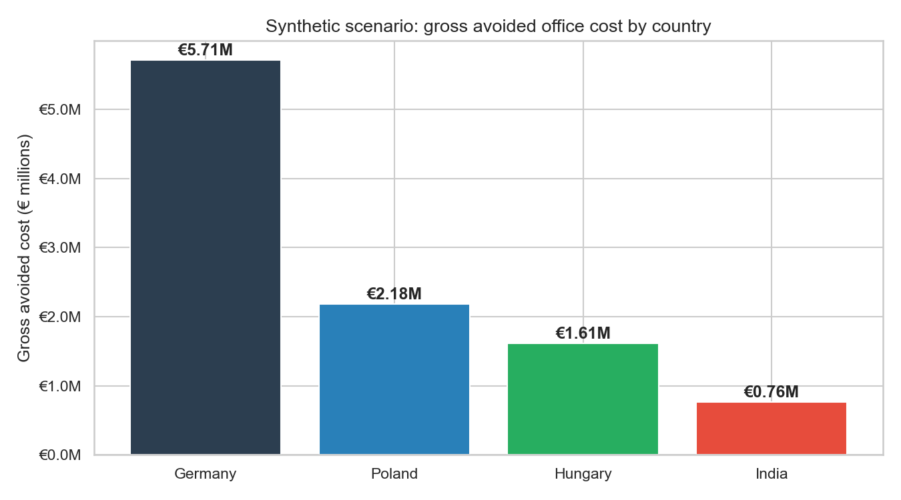

# Remote-work workforce simulation

[](https://github.com/yousufpatel41-collab/remote-work-analysis/actions)

A personal portfolio simulation with 2,000 synthetic employee records across Germany, Poland, Hungary and India. It demonstrates grouped analysis, charts and SQL queries. The public data is generated by this repository, not collected from BMW or an employer.

## Run

Use Python 3.11 or 3.12 in a virtual environment, from the repository root:

```shell
pip install -r requirements.txt
python src/generate_data.py
python src/analyse.py
python -m unittest discover -s tests -v
```

The generator uses seed 42 and writes `data/synthetic_workforce_data.csv`. The analysis writes `outputs/adoption_by_country.png`, `outputs/productivity_by_workmode.png`, `outputs/cost_savings_simulation.png` and `outputs/kpi_summary.csv`. Import `data/synthetic_workforce_data.csv` as a table called `workforce` to try `src/sql_queries.sql`; adapt functions to your SQL dialect. There is no saved notebook or Power BI dashboard.

## Assumptions

Country record counts are Germany 800, Poland 500, Hungary 400 and India 300. Work-mode probabilities are configured in `COUNTRIES`, not estimated from real surveys. The generator explicitly assigns productivity means of 7.0 for remote, 7.6 for hybrid and 7.2 for office, with random noise. Therefore a hybrid productivity advantage reflects an input assumption, not a finding about real workers.

Annual office costs are assumed to be €12,000, €7,000, €6,500 and €3,500 respectively. Remote records assume 100% avoided office cost; hybrid records assume 50%; office records assume 0%. The totals omit implementation, equipment and other remote-work costs. They represent a simplified gross scenario, not realised savings or a business recommendation.





## Validation

Tests check unique employee IDs, country coverage, bounded scores, equal headcounts across data and summaries, the gross cost assumptions and execution of all seven SQL queries against SQLite. Every chart is labelled as a synthetic scenario.

## Licence and data rights

Project code and documentation: [MIT](LICENSE). External datasets retain their own terms; see [DATA_SOURCES.md](DATA_SOURCES.md).
